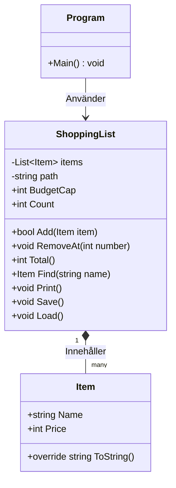

# Felrapport

1. Programmet kraschar vid inmatning av bokstäver där menyn ville ha siffor. 
Koden använde int.Parse() som kastar ett FormatException som stäner ner programmet om talet inte kan omvandlas till ett heltal.
Jag bytte ut int.Parse() mot int.TryParse, med en while-loop. Programmet ber nu användaren att försöka igen, istället för att krascha.

2. Programmet kraschar när användaren tar bort en vara som inte finns.
items.RemoveAt(number -1) anropades utan att kontrollera om det angivna indexet fanns i listan.
Jag lade till en Count-egenskap i Shoppinglist och uppdaterade Program.cs som säkerställer att det användaren matar in ligger mellan 1 och listans storlek.

3. Programmet kraschar om items.txt döps om eller saknas.
Metoden Load() försökte läsa textfilen med ReadAllText(), utan att undersöka om filen fanns på hårddisken.
Jag lade till en kontroll med File.Exists(path). Saknas filen avbryts inläsningen med return, och programmet startar med en tom lista.

4. Totalsumman stämde inte när man räknade för hand. Programmet räknade inte med den första varan.
I metoden Total() startade for-loopen på index 1 istället för 0, därför hoppades den första varans pris över.
Jag ändrade loopens startindex till 0, vilket gör att även den första varans pris i listan nu räknas med i totalsumman.

5. Sökfunktionen var skriftlägeskänslig och misslyckades med att hitta varor om man till exempel använde stor boksta i början, istället för liten bokstav.
Strängjämförelsen gjordees med == , som är skriftlägeskänslig.
Jag uppdaterade metoden Find() att använda item.Name.Equals(name, StringComparison.OrdinalIgnoreCase), så att sökningen fungerar oavsett små eller stora bokstäver. Jag lade även till null-kontroller mot tomma rader.

6. Varornas namn var tomma när programmet startades, vilket även gjorde att det inte gick att söka efter varor.
Filen splittades fel på \n istället för kompletta radbrytningar. Måsvingar saknades i loopen vilket gjorde inläsningen fel.
Jag gjorde om Load() att använda File.ReadAllLines() så filen läses in rad för rad.

# Designval
Jag valde att Add-metoden ska returnera true eller false när listans tak överskrids.
Om Add returnerar true så läggs varan till.
Om Add returnerar false så stoppas varan från att läggas till eftersom att budgettaket överskrids. Programmet skriver ut att varan inte kunde läggas till, och fortsätter sedan som vanligt.

# Klassdiagram
