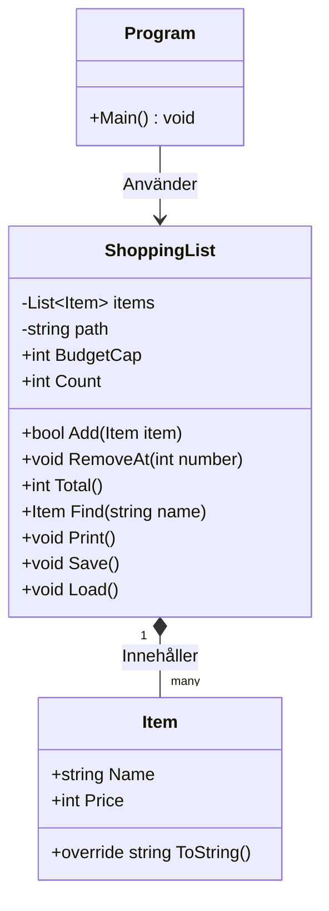

# Felrapport

1. Programmet kraschar vid inmatning av bokstäver där menyn ville ha siffor. 
Koden använde int.Parse() som kastar ett FormatException som stänger ner programmet om talet inte kan omvandlas till ett heltal.
Jag bytte ut int.Parse() mot int.TryParse, med en while-loop. Programmet ber nu användaren att försöka igen, istället för att krascha.

2. Programmet kraschar när användaren tar bort en vara som inte finns.
items.RemoveAt(number -1) anropades utan att kontrollera om det angivna indexet fanns i listan.
Jag lade till en Count-egenskap i Shoppinglist och uppdaterade Program.cs som säkerställer att det användaren matar in måste vara minst 1 och högst listans storlek. Annars får användaren försöka igen.

3. Programmet kraschar om items.txt döps om eller saknas.
Metoden Load() försökte läsa textfilen med ReadAllText(), utan att undersöka om filen fanns på hårddisken.
Jag lade till en kontroll med File.Exists(path). Saknas filen avbryts inläsningen med return, och programmet startar med en tom lista.

4. Totalsumman stämde inte när man räknade för hand. Programmet räknade inte med den första varan.
I metoden Total() startade for-loopen på index 1 istället för 0, därför hoppades den första varans pris över.
Jag ändrade loopens startindex till 0, vilket gör att även den första varans pris i listan nu räknas med i totalsumman.

5. Programmet kraschade direkt vid start, varornas namn var tomma och det gick inte att söka efter varor. 
Filen splittades på \n istället för kompletta radbrytningar.
Jag gjorde om Load() att använda File.ReadAllLines() så filen läses in rad för rad.

6. Programmet skrev "Listan är sparad" även när sparandet misslyckades.
I Save() fanns en tom catch, och utskriften låg efter try/catch så den alltid kördes.
Jag flyttade utskriften in i try-blocket så att den endast körs om skrivningen lyckas, och jag ersatte den tomma catchen med catch för IOException och UnauthorizedAccessException som skriver ut vad som gick fel.

Inget av de sex felen, men kanske ändå värt att nämna: Sökfunktionen var skriftlägeskänslig och misslyckades med att hitta varor om man till exempel använde stor boksta i början, istället för liten bokstav. 

# Designval
Jag valde att Add-metoden ska returnera en bool: true om varan lades till, och false om listans tak överskrids.
Om Add returnerar true så läggs varan till.
Om Add returnerar false så stoppas varan från att läggas till eftersom att budgettaket överskrids. Programmet skriver ut att varan inte kunde läggas till, och fortsätter sedan som vanligt. Anledningen till mitt val är att det vid normal användning faktiskt kan hända att budgettaket överskrids, men det är inget "riktigt" fel. Därför returnerar Add false i stället för att kasta ett undantag, och undantag väljer jag att i stället använda vid verkliga fel, som till exempel ett objekt med tomt namn. Program.cs behöver bara kontrollera svaret med en if och skriva ut ett meddelande om det blev false.

# Klassdiagram
